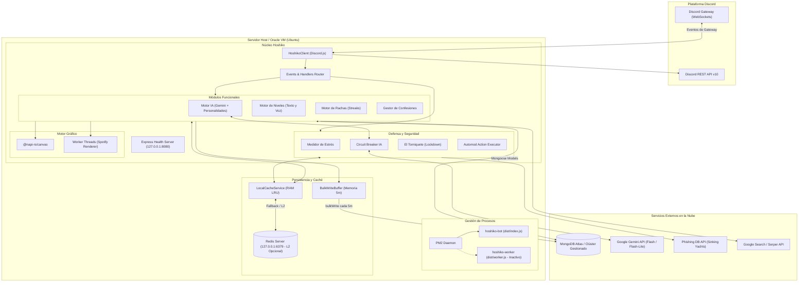
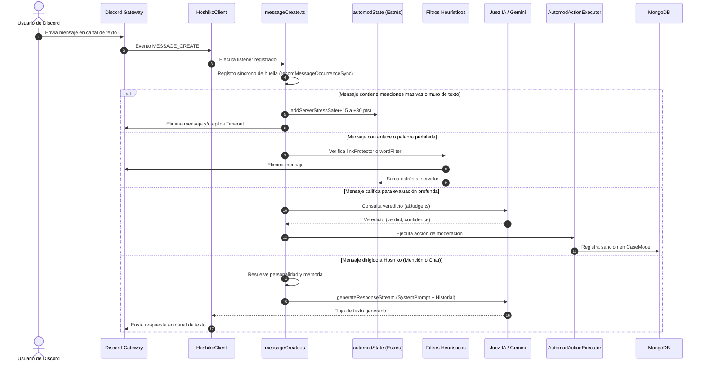

# Visión General y Arquitectura Técnica de Hoshiko (HannaeX)

---

## 1. Introducción a Hoshiko

**Hoshiko** (nombre de proyecto interno en repositorio: **HannaeX**) es un bot multipropósito avanzado para la plataforma Discord, diseñado con una arquitectura modular sobre Node.js y TypeScript.

A diferencia de bots utilitarios estándar de propósito único, Hoshiko opera como un ecosistema integral que combina:
- **Inteligencia Artificial Conversacional:** Asistente interactiva de lenguaje natural impulsada por la familia de modelos Google Gemini, dotada de múltiples arquetipos de personalidad (*neko*, *maid*, *gymbro*, *yandere*, *assistant*, *tsundere*, *borracha*), memoria episódica a largo plazo y absorción de cultura comunitaria por servidor.
- **Sistema de Moderación y Defensa Reactiva:** Filtrado heurístico de contenido, protección contra enlaces maliciosos y phishing sincronizado en la nube, moderación asistida por IA con Juez contextual determinista, medidor de estrés del servidor, protocolo de contención de emergencia (*El Torniquete* / *Lockdown*) y centros de gestión reactiva mediante componentes de interfaz de Discord.
- **Economía y Gamificación Comunitaria:** Motor de progresión y niveles en dos niveles (local por gremio y global), seguimiento de actividad en chat y canales de voz (*Voice XP*), logros, rachas de interacción diarias individuales y grupales (*Streaks*), sistema de emparejamiento (*Love / Ship*) y tarjetas de interacción social.
- **Mecanismos de Expresión y Soporte:** Sistema confidencial y anónimo de confesiones con hilos y auditoría privada para moderadores, sistema de sugerencias, rastreo de avatares/apodos históricos y generación de tarjetas gráficas dinámicas de alto rendimiento mediante renderizado nativo en Canvas.

---

## 2. Propósito y Alcance Actual

El proyecto está diseñado para proporcionar una solución de infraestructura social completa para comunidades de Discord públicas, privadas y de gran escala.

### Alcance Implementado y Confirmado:
1. **Comandos Slash y Comandos con Prefijo:** Despliegue dual de interacciones modernas vía REST Discord API v10 (`/`) y soporte de comandos de texto con prefijo configurable (por defecto `x` o `!`).
2. **Capa de Persistencia NoSQL Centralizada:** Base de datos MongoDB modelada a través de Mongoose 8, particionada por dominios de negocio sin barriles globales.
3. **Caché Multinivel de Alta Concurrencia:** Estrategia L1 en memoria de proceso (LRU) y L2 distribuido opcional sobre Redis, diseñada para soportar caídas de Redis sin detener la operación del bot.
4. **Renderizado Gráfico Off-Thread:** Motor `@napi-rs/canvas` ejecutado directamente o delegado a *Worker Threads* de Node.js para no bloquear el bucle de eventos (*Event Loop*) durante la creación de imágenes complejas (Spotify, tarjetas de racha, niveles y relaciones).
5. **Servidor HTTP de Monitoreo:** Micro-servidor interno Express para comprobaciones de estado de salud (*Health Checks*) y sondas Kubernetes/Docker (`/healthz`, `/healthz/live`, `/healthz/ready`, `/healthz/details`).
6. **Ciclo de Vida y Apagado Ordenado:** Interceptores de señales de sistema (`SIGTERM`, `SIGINT`, `uncaughtException`) que coordinan el drenado de tareas, desconexión de clientes y desconexión segura con temporizador de corte forzado (*Kill Switch*).

### Límites Fuera del Alcance Actual:
- No existe un panel de control web (*Dashboard*) externo para usuarios en este repositorio; la configuración se administra íntegramente mediante comandos slash interactivos (`/setup`, `/setup-automod`, `/setup-logs`).
- La arquitectura de workers BullMQ se encuentra preparada a nivel de interfaces de cola, pero los procesos trabajadores de fondo se encuentran inactivos por diseño (`WORKER_ENABLED=false`).

---

## 3. Estado de la Auditoría y Fecha

- **Fecha de realización:** 4 de noviembre de 2026.
- **Rama auditada:** `master`.
- **Commit analizado:** [`99590f3`](file:///home/hanna/HannaeX) (*Merge pull request #3 from XeSuzu/fix/auditoria*).
- **Estado de Pruebas Unitarias:** 171 pruebas unitarias ejecutadas y superadas satisfactoriamente (tiempo de suite: ~100 segundos con transpilación previa).
- **Entorno de Inspección:** Sistema Linux x86_64, Node.js v26.12.1, npm 12.2.1.
- **Acceso a Infraestructura:** Verificación estática sobre código fuente, configuración de despliegue PM2 ([`ecosystem.config.js`](file:///home/hanna/HannaeX/ecosystem.config.js)), contenedorización ([`Dockerfile`](file:///home/hanna/HannaeX/Dockerfile)), documentación operacional de Oracle VM y scripts de despliegue.

---

## 4. Estructura del Repositorio

El código fuente reside bajo [`src/`](file:///home/hanna/HannaeX/src/) y se compila al directorio [`dist/`](file:///home/hanna/HannaeX/dist/) mediante TypeScript.

```text
HannaeX/
├── .agents/                 # Reglas y skills de agentes de desarrollo
├── assets/                  # Recursos estáticos: fuentes tipográficas (.ttf)
├── docs/                    # Documentación técnica, inventarios y guías de infraestructura
│   └── operations/          # Procedimientos de PM2, Redis y despliegue en VM
├── scripts/                 # Scripts auxiliares de testing y automatización
├── src/                     # Código fuente principal en TypeScript
│   ├── App/                 # Infraestructura base, configuración Zod, caché L1, colas y salud
│   │   ├── config/          # Validación de entorno Zod (AppConfig, envSchema)
│   │   ├── health/          # Métricas de estado de salud y snapshots operativos
│   │   └── infrastructure/  # Servicios de Redis, LocalCacheService (LRU), QueueService
│   ├── bootstrap/           # Cargadores de handlers y arranque desacoplado
│   ├── client/              # Factoría y extensión de HoshikoClient (Discord.js Client)
│   ├── Commands/            # Comandos del bot
│   │   ├── PrefixCmds/      # Comandos de texto clásicos agrupados por categoría
│   │   └── SlashCmds/       # Comandos de barra '/' (14 dominios funcionales)
│   ├── config/              # Carga de entorno dotenv y centralización de modelos IA
│   ├── Database/            # Capa de datos Mongoose organizada estrictamente por dominio
│   │   ├── ai/              # Memorias a largo plazo, conversaciones e IA config
│   │   ├── community/       # Confesiones, parejas, sugerencias y roles por reacción
│   │   ├── guild/           # Configuración del servidor, licencias y caché de settings
│   │   ├── leveling/        # Niveles locales, globales, voz, roles y ranking semanal
│   │   ├── moderation/      # Casos, advertencias, episodios de raid y suspensiones
│   │   ├── streaks/         # Rachas grupales y miembros de racha
│   │   ├── system/          # Locks distribuidos, buffers de escritura masiva y métricas
│   │   └── tracking/        # Historial de avatares, nombres, AFK y sesiones de voz
│   ├── Events/              # Manejadores de eventos de Discord Gateway
│   │   └── Client/          # Eventos de cliente, guilds, mensajes, voz e interacciones
│   │       ├── Guilds/      # Eventos de servidor (anti-nuke, entradas, borrado de canales)
│   │       └── handlers/    # Procesadores de botones, modales, comandos y autocompletado
│   ├── Features/            # Lógica de negocio de alto nivel
│   │   ├── ai/              # Contexto conversacional, políticas de contenido y respuestas
│   │   ├── automod/         # Juez IA, motor de estrés, alertas de raid, filtro de palabras
│   │   └── leveling/        # Cálculo de XP de texto, voz y anuncios
│   ├── Handlers/            # Cargadores dinámicos de comandos y eventos
│   ├── http/                # Servidor HTTP Express de comprobación de salud (/healthz)
│   ├── Interfaces/          # Contratos TypeScript para comandos, eventos y configuración
│   ├── lifecycle/           # Manejadores de apagado limpio (Graceful Shutdown)
│   ├── Renderers/           # Generadores gráficos con Canvas (Spotify, Roblox, Cards)
│   ├── scripts/             # Tareas programadas cronJobs y despliegue de comandos REST
│   ├── Security/            # Registro centralizado HoshikoLogger, monitores y defensas
│   ├── Services/            # Servicios externos (Gemini, Mongo, Búsqueda, Letras, Snipe)
│   ├── Utils/               # Utilidades de Discord, filtros, anti-crash y validaciones
│   ├── workers/             # Scripts para ejecución en Worker Threads dedicados
│   ├── index.ts             # Punto de entrada coordinador del proceso Bot
│   └── worker.ts            # Punto de entrada del proceso Worker (Background queues)
├── tests/                   # Pruebas automatizadas del sistema
│   └── unit/                # 31 suites de tests unitarios (.test.cjs) ejecutadas con node --test
├── Dockerfile               # Manifiesto de contenedor Docker (Node 20 Alpine)
├── ecosystem.config.js      # Declaración de aplicaciones para el orquestador PM2
├── package.json             # Manifiesto de dependencias y scripts del proyecto
└── tsconfig.json            # Configuración de compilación TypeScript (ES2020 / Node16)
```

---

## 5. Lenguajes de Programación

1. **TypeScript (v5.9.3):**
   - **Ámbito:** La totalidad del código de aplicación en [`src/`](file:///home/hanna/HannaeX/src/).
   - **Responsabilidad:** Garantizar tipado estricto, interfaces para contratos de comandos, esquemas fuertemente tipados en Mongoose e inferencia estricta con Zod.
   - **Compilación:** Se compila a JavaScript moderno mediante `tsc` emitiendo archivos en `dist/`. No se utiliza ejecución transpilada en tiempo de ejecución para producción; en producción se ejecuta JavaScript nativo puro.

2. **JavaScript (ES2020 / Node16 CommonJS):**
   - **Ámbito:** Salida compilada en [`dist/`](file:///home/hanna/HannaeX/dist/), suite de tests unitarios en [`tests/unit/*.test.cjs`](file:///home/hanna/HannaeX/tests/unit/) y configuración de procesos [`ecosystem.config.js`](file:///home/hanna/HannaeX/ecosystem.config.js).
   - **Responsabilidad:** Los tests se mantienen como archivos `.test.cjs` para ser ejecutados de forma ultrarrápida por el ejecutor nativo `node --test` directamente sobre los módulos compilados en `dist/`, sin sobrecarga de transpiladores en memoria.

3. **JSON:**
   - **Ámbito:** [`package.json`](file:///home/hanna/HannaeX/package.json), [`tsconfig.json`](file:///home/hanna/HannaeX/tsconfig.json), archivos de traducción y datos empaquetados.
   - **Responsabilidad:** Declaración de metadatos, resolución de compilador y configuraciones estáticas.

4. **Shell / Bash:**
   - **Ámbito:** [`scripts/test.sh`](file:///home/hanna/HannaeX/scripts/test.sh).
   - **Responsabilidad:** Coordinador de pruebas de integración continua y desarrollo local que concatena la compilación limpia y el lanzamiento de las pruebas con inyección de variables de entorno de ruta.

---

## 6. Runtime y Entorno de Ejecución

- **Motor de ejecución:** Node.js (Versión objetivo: Node.js >= 20.x; comprobado en entorno local con Node.js v26.12.1).
- **Gestor de paquetes:** `npm` (v12.2.1). La instalación limpia de dependencias está estandarizada mediante `npm ci`.
- **Sistema de Módulos:** CommonJS compatible con resolución `Node16` (`"module": "Node16"`, `"moduleResolution": "node16"`).
- **Gestión de Entornos:** La configuración se segmenta por la variable `NODE_ENV`:
  - `development`: Carga `.env.development`.
  - `staging`: Carga `.env.staging`.
  - `production`: Carga `.env.production`.
  - `test`: Carga `.env.test`.
  La carga es administrada por [`src/config/loadEnvironment.ts`](file:///home/hanna/HannaeX/src/config/loadEnvironment.ts) sin sobreescribir variables ya inyectadas por el sistema operativo o PM2.
- **Validación Estricta:** [`src/App/config/AppConfig.ts`](file:///home/hanna/HannaeX/src/App/config/AppConfig.ts) valida las variables de entorno mediante un esquema [Zod](https://zod.dev) ([`src/App/config/envSchema.ts`](file:///home/hanna/HannaeX/src/App/config/envSchema.ts)). Si variables críticas como `MONGO_URI` faltan o tienen formatos erróneos, la aplicación se detiene antes de abrir sockets de red.

---

## 7. Frameworks y Dependencias

A continuación se auditan las dependencias fundamentales declaradas en [`package.json`](file:///home/hanna/HannaeX/package.json):

| Tecnología | Responsabilidad | Dónde se utiliza | Importancia y Comportamiento ante Fallo |
| :--- | :--- | :--- | :--- |
| **`discord.js` (v14.25.1)** | SDK oficial de interacción con la API de Discord Gateway y REST. | [`src/client/`](file:///home/hanna/HannaeX/src/client/), [`src/Events/`](file:///home/hanna/HannaeX/src/Events/), [`src/Commands/`](file:///home/hanna/HannaeX/src/Commands/) | **Crítica.** Si falla la conexión con el Gateway de Discord, el bot no puede recibir eventos ni enviar mensajes. |
| **`mongoose` (v8.17.1)** | ODM para persistencia en base de datos MongoDB. | [`src/Database/`](file:///home/hanna/HannaeX/src/Database/), [`src/Services/mongo.ts`](file:///home/hanna/HannaeX/src/Services/mongo.ts) | **Crítica.** Almacena configuraciones, historiales, niveles y sanciones. Si cae, [`mongo.ts`](file:///home/hanna/HannaeX/src/Services/mongo.ts) aplica reintentos con backoff exponencial. |
| **`ioredis` (v6.0.0)** | Cliente de alto rendimiento para Redis L2 y caché distribuida. | [`src/App/infrastructure/redis/`](file:///home/hanna/HannaeX/src/App/infrastructure/redis/) | **Opcional / Resiliente.** Si Redis no está disponible o falla, la aplicación conmuta silenciosamente a `LocalCacheService` en RAM. |
| **`@google/generative-ai` (v0.24.1)** | SDK de Google Gemini para procesamiento de lenguaje natural y Juez IA. | [`src/Services/gemini.ts`](file:///home/hanna/HannaeX/src/Services/gemini.ts), [`src/Features/automod/aiJudge.ts`](file:///home/hanna/HannaeX/src/Features/automod/aiJudge.ts) | **Importante.** Si la API falla o agota su cuota, el Circuit Breaker degrada a expresiones regulares locales sin tumbar el bot. |
| **`@napi-rs/canvas` (v0.1.90)** | Motor gráfico de renderizado 2D nativo de alto rendimiento (basado en Skia). | [`src/Renderers/`](file:///home/hanna/HannaeX/src/Renderers/), [`src/Services/CardService.ts`](file:///home/hanna/HannaeX/src/Services/CardService.ts) | **Importante.** Permite generar imágenes en búfer de memoria. Evita fugas de memoria al no usar bindings C++ anticuados. |
| **`express` (v5.1.0)** | Microservidor HTTP para inspección de salud operativa. | [`src/http/healthServer.ts`](file:///home/hanna/HannaeX/src/http/healthServer.ts) | **Secundaria.** Expone endpoints `/healthz` en `127.0.0.1:8080`. Si el servidor HTTP falla, se captura sin abortar el cliente de Discord. |
| **`zod` (v4.6.6)** | Validación de esquemas de datos y variables de entorno. | [`src/App/config/envSchema.ts`](file:///home/hanna/HannaeX/src/App/config/envSchema.ts) | **Crítica en arranque.** Asegura que tipos numéricos, booleanos y cadenas de configuración sean válidos antes de iniciar. |
| **`node-cron` (v4.2.1)** | Programador de tareas periódicas basadas en expresiones cron. | [`src/scripts/cronJobs.ts`](file:///home/hanna/HannaeX/src/scripts/cronJobs.ts) | **Importante.** Ejecuta la expiración de rachas (cada 15 min), purga de logs antiguos (3:00 AM) y vencimiento de sanciones temporales. |
| **`lru-cache` (v11.5.3)** | Algoritmo de reemplazo de caché en memoria acotada por recencia. | [`src/App/infrastructure/cache/LocalCacheService.ts`](file:///home/hanna/HannaeX/src/App/infrastructure/cache/LocalCacheService.ts) | **Fundamental.** Evita fugas de memoria limitando las entradas en RAM mediante conteo máximo (`max`) y TTL estricto. |
| **`axios` (v1.20.0)** | Cliente HTTP para consumo de APIs REST externas. | [`src/Features/linkProtector.ts`](file:///home/hanna/HannaeX/src/Features/linkProtector.ts), [`src/Services/search.ts`](file:///home/hanna/HannaeX/src/Services/search.ts) | **Importante.** Consume la API de listas de phishing (`phish.sinking.yachts`) y búsqueda de Google. Cuenta con timeouts estrictos. |
| **`bullmq` (v6.3.12)** | Gestor de colas de mensajes distribuidas basadas en Redis Streams. | [`src/App/infrastructure/queue/`](file:///home/hanna/HannaeX/src/App/infrastructure/queue/) | **Preparada / Inactiva.** Sus interfaces están listas para enrutar tareas en background en futuras fases de escalabilidad. |
| **`genius-lyrics` (v4.4.7)** | Extracción de letras de canciones para el comando de música. | [`src/Services/Lyrics/`](file:///home/hanna/HannaeX/src/Services/Lyrics/) | **Auxiliar.** Proporciona soporte de búsqueda de letras en Genius. |
| **`pm2` (v7.0.4)** | Gestor de procesos y monitor de infraestructura en servidor. | [`ecosystem.config.js`](file:///home/hanna/HannaeX/ecosystem.config.js) | **Operacional.** Mantiene el bot activo, administra reinicios automáticos y rotación de salidas en producción. |

---

## 8. Arquitectura de Discord.js

Hoshiko implementa una configuración granular del cliente Discord.js v14 en [`src/client/HoshikoClient.ts`](file:///home/hanna/HannaeX/src/client/HoshikoClient.ts):

### A. Intents y Consumo de Gateway
El bot declara los siguientes *Gateway Intents* obligatorios:
- `Guilds`: Gestión estructural de servidores, canales y roles.
- `GuildMessages`: Recepción de eventos de mensajes en servidores.
- `MessageContent`: **Intent privilegiado** requerido para inspeccionar texto en filtros de automod, chat con IA y comandos de prefijo.
- `GuildMembers`: **Intent privilegiado** necesario para el detector de ingresos, anti-alt, verificación y gestión de roles.
- `GuildPresences`: Seguimiento de estados para la tarjeta interactiva de actividad en Spotify.
- `GuildMessageReactions`: Roles por reacción y votos comunitarios.
- `GuildVoiceStates`: Monitoreo de actividad de voz para concesión de Voice XP y detección de spam de cambios de canal (*VC Thrashing*).

### B. Optimización de Memoria (Partials y Cache Limits)
Para evitar el crecimiento ilimitado del consumo de memoria RAM en servidores masivos, Hoshiko utiliza `Options.cacheWithLimits`:
- `MessageManager`: Límite estricto de **50 mensajes** en caché por canal.
- `PresenceManager`: Límite de **1.000 presencias**.
- `UserManager` y `GuildMemberManager`: Límite de **1.000 entidades**, asegurando conservar permanentemente en caché solo al propio bot (`keepOverLimit`).
- `Partials`: Se declaran `Partials.Message`, `Partials.Channel` y `Partials.Reaction` para recibir eventos sobre recursos antiguos no retenidos en la memoria local.

### C. Registro y Ciclo de Comandos
1. **Comandos Slash:** Definidos en [`src/Commands/SlashCmds/`](file:///home/hanna/HannaeX/src/Commands/SlashCmds/). Se registran en la API de Discord mediante el script independiente [`src/scripts/deploy-commands.ts`](file:///home/hanna/HannaeX/src/scripts/deploy-commands.ts). Soporta despliegue por servidor inmediato para desarrollo (`deploy:dev`, `deploy:guild`) o despliegue global con propagación en Discord (`deploy:global`).
2. **Despacho de Interacciones:** Capturado en [`src/Events/Client/interactionCreate.ts`](file:///home/hanna/HannaeX/src/Events/Client/interactionCreate.ts) y enrutado según el tipo:
   - Comandos slash: [`src/Events/Client/handlers/command.ts`](file:///home/hanna/HannaeX/src/Events/Client/handlers/command.ts).
   - Componentes interactivos (botones/menús): [`src/Events/Client/handlers/components.ts`](file:///home/hanna/HannaeX/src/Events/Client/handlers/components.ts).
   - Ventanas emergentes: [`src/Events/Client/handlers/modals.ts`](file:///home/hanna/HannaeX/src/Events/Client/handlers/modals.ts).
   - Autocompletado dinámico: [`src/Events/Client/handlers/autocomplete.ts`](file:///home/hanna/HannaeX/src/Events/Client/handlers/autocomplete.ts).

---

## 9. Módulos Funcionales

El bot contiene 14 áreas de responsabilidad claramente identificables:

```text
[Interacción del Usuario]
       │
       ├──► 1. IA Conversacional y Cultura (aiHandler.ts, cultureHandler.ts)
       ├──► 2. Moderación y Automod (aiModeration.ts, automodState.ts, wordFilter.ts)
       ├──► 3. Anti-Raid y Contención (raidAlertManager.ts, guildMemberAdd.ts)
       ├──► 4. Anti-Nuke y Honeypot (antiNukeBans.ts, honeypotHandler.ts)
       ├──► 5. Confesiones Comunitarias (ConfessionManager.ts, confession.model.ts)
       ├──► 6. Niveles y Experiencia (textXp.ts, voiceXp.ts, localLevel.model.ts)
       ├──► 7. Rachas Diarias / Streaks (StreakService.ts, streakGroup.model.ts)
       ├──► 8. Parejas y Matrimonios (match.ts, ship.ts, couple.model.ts)
       ├──► 9. Roles por Reacción (reactionAdd.ts, reactionRoles.models.ts)
       ├──► 10. Sistema AFK (afkHandler.ts, afk.model.ts)
       ├──► 11. Snipe y Consentimiento (SnipeService.ts, SnipeConsentService.ts)
       ├──► 12. Rastreo de Identidad (UserHistoryManager.ts, AvatarHistoryManager.ts)
       ├──► 13. Tarjetas Gráficas Canvas (spotifyRenderer.ts, robloxRenderer.ts)
       └──► 14. Logs y Auditoría (HoshikoLogger.ts, setup-logs.ts)
```

1. **Inteligencia Artificial Conversacional:** Chat contextual con memoria episódica, detección de temas, inyección de reglas del servidor y adaptación de dialecto local.
2. **Moderación y AutoMod:** Sanciones por menciones masivas, muros de texto, repeticiones mono/multi-cuenta, enlaces de phishing y palabras prohibidas.
3. **Centro Anti-Raid:** Detección de ráfagas de nuevos miembros, cálculo de riesgo por cuenta reciente sin avatar, análisis forense con Gemini y aislamiento mediante botones interactivos de lote.
4. **Protección Anti-Nuke y Honeypot:** Monitoreo de eliminaciones masivas de canales o roles y degradación automática de ejecutores sospechosos.
5. **Confesiones:** Sistema anónimo que crea hilos en foros o mensajes embed personalizados, manteniendo un registro forense oculto para evitar abusos.
6. **Sistema de Niveles (Local y Global):** Ganancia de XP por texto y tiempo de voz, cálculo de ranking, roles de recompensa y tablas de clasificación semanales y globales.
7. **Rachas (Duo y Grupales):** Ciclos de interacción diaria de 24 horas entre 2 o más usuarios, con niveles progresivos (*Mayoi* a *Kiseki*), congelamientos y conmemoración en Salón de la Fama.
8. **Interacciones y Parejas:** Registro de besos y compatibilidad social con tarjeta de afinidad generada en Canvas.
9. **Roles por Reacción:** Asignación automática de roles mediante interacción con reacciones en mensajes predeterminados.
10. **Módulo AFK:** Guarda estado de ausencia y notifica en el chat cuando el usuario es mencionado, desactivándose al enviar un nuevo mensaje.
11. **Snipe con Consentimiento:** Recuperación del último mensaje eliminado en el canal, sujeto a la política de consentimiento del autor ([`SnipeConsentService.ts`](file:///home/hanna/HannaeX/src/Services/SnipeConsentService.ts)).
12. **Rastreo de Usuarios y Avatares:** Almacenamiento histórico de cambios de nombres de usuario, apodos y avatares para facilitar labores de auditoría.
13. **Renderizadores Gráficos:** Creación de tarjetas de estado para perfiles de Spotify, Roblox y fichas de nivel en formato PNG.
14. **Centro de Logs:** Enrutamiento segmentado de registros a canales específicos (`modlog`, `serverlog`, `joinlog`, `confesslog`, `messagelog`, `voicelog`).

---

## 10. Persistencia: MongoDB

MongoDB constituye la fuente única de verdad permanente del proyecto, gestionada a través de Mongoose.

- **Conexión y Resiliencia:** Centralizada en [`src/Services/mongo.ts`](file:///home/hanna/HannaeX/src/Services/mongo.ts). La función `connectWithRetry` aplica hasta 6 intentos de conexión espaciados por 5 segundos. Las opciones del socket están configuradas para estabilidad en red:
  ```ts
  maxPoolSize: 10,
  serverSelectionTimeoutMS: 30000,
  socketTimeoutMS: 45000,
  family: 4
  ```
- **Esquemas por Dominio:**

| Dominio | Modelo / Colección | Responsabilidad | Índices Clave |
| :--- | :--- | :--- | :--- |
| **Guild** | `ServerConfig` | Configuración completa por servidor: prefijo, módulos de seguridad, canales de logs, personalidad IA, reglas. | `{ guildId: 1 }` (Unique) |
| **Guild** | `StatusConfig` | Mensaje de presencia rotativa del bot y estado visual. | Estándar |
| **Moderación** | `CaseModel` (`cases`) | Historial inmutable de sanciones aplicadas (warn, timeout, kick, ban). | `{ guildId: 1, caseId: 1 }` (Unique), `{ guildId: 1, userId: 1, createdAt: -1 }` |
| **Moderación** | `RaidEpisodeModel` | Registro forense de incursiones detectadas, IDs de atacantes y estado de resolución. | `{ episodeId: 1 }` (Unique), `{ guildId: 1, createdAt: -1 }` |
| **Moderación** | `GlobalBlacklist` | Lista negra global compartida entre servidores (Sentinel Network). | `{ userId: 1 }` (Unique) |
| **Moderación** | `GlobalProfile` | Nivel global, reputación y factor de confianza (*Trust Factor*). | `{ userId: 1 }` (Unique) |
| **Moderación** | `TempModeration` | Registro de silencios y baneos temporales para desaplicación programada. | `{ guildId: 1, userId: 1, tipo: 1 }` (Unique), `{ activo: 1, expiresAt: 1 }` |
| **Leveling** | `LocalLevel` | Experiencia (XP), nivel, mensajes y minutos de voz por servidor. | `{ userId: 1, guildId: 1 }` (Unique), `{ guildId: 1, xp: -1 }` |
| **Leveling** | `GlobalLevel` | Experiencia consolidada global del usuario a través de todos los servidores. | `{ userId: 1 }` (Unique), `{ xp: -1 }` |
| **Leveling** | `ActiveVoiceSession` | Sesiones de voz en curso para cálculo de tiempo acumulado. | `{ userId: 1, guildId: 1 }` (Unique) |
| **Streaks** | `StreakGroup` | Grupos de racha, contadores de días, estado (*active*, *frozen*), historial de roturas. | `{ guildId: 1, status: 1 }`, `{ memberIds: 1 }` |
| **Community** | `Confession` | Confesiones anónimas o públicas, enlaces a mensajes y datos de autoría privados. | `{ guildId: 1, confessionId: 1 }`, `{ authorId: 1 }` |
| **Community** | `Couple` | Registro de parejas y contadores de afecto (*kisses*). | `{ users: 1 }` |
| **AI** | `Conversation` | Historial de los últimos 40 mensajes entre usuario y bot para contexto conversacional. | `{ userId: 1, guildId: 1 }` (Unique) |
| **AI** | `UserMemory` | Hechos y recuerdos personales detectados por la IA sobre el usuario. | `{ userId: 1, guildId: 1 }` (Unique) |
| **Tracking** | `UserHistory` | Historial de nombres, apodos y discriminadores pasados del usuario. | `{ userId: 1 }` (Unique) |
| **Tracking** | `AvatarHistory` | Registro histórico de URLs de fotos de perfil usadas por el usuario. | `{ userId: 1, guildId: 1 }` (Unique) |
| **System** | `InteractionLock` | Bloqueo distribuido para evitar doble procesamiento de interacciones. | `{ createdAt: 1 }` (**TTL Index: 15s**) |

- **Escrituras Masivas (BulkWriteBuffer):** [`src/Database/system/BulkWriteBuffer.ts`](file:///home/hanna/HannaeX/src/Database/system/BulkWriteBuffer.ts) acumula en memoria los incrementos menores de mensajes y reputación durante 5 minutos, volcándolos en una sola llamada `bulkWrite` a MongoDB para reducir la carga de E/S.

---

## 11. Caché y Concurrencia: Redis

El servicio de Redis es gestionado mediante [`src/App/infrastructure/redis/RedisClient.ts`](file:///home/hanna/HannaeX/src/App/infrastructure/redis/RedisClient.ts) utilizando la librería `ioredis`.

- **Diseño Resiliente y Opcional:** Redis está configurado para que su ausencia nunca bloquee el bot. Si `REDIS_ENABLED=false` o si la conexión falla en tiempo de ejecución, el estado conmuta a `"degraded"` o `"disabled"` y las lecturas caen limpiamente a la capa L1 ([`LocalCacheService`](file:///home/hanna/HannaeX/src/App/infrastructure/cache/LocalCacheService.ts)) o a MongoDB.
- **Estructura de Claves:** Implementada en [`src/App/infrastructure/redis/RedisKeys.ts`](file:///home/hanna/HannaeX/src/App/infrastructure/redis/RedisKeys.ts):
  ```text
  hannaex:<environment>:<scope>:<key>
  ```
  Ejemplo: `hannaex:production:guild_cfg:123456789012345678` o `hannaex:production:stress:123456789012345678`.
- **Ámbitos de Uso de Redis:**
  1. **Configuración de Servidores (L2):** Caché de `ServerConfig` con TTL de 600 segundos (10 minutos) que evita consultar la base de datos en mensajes repetitivos.
  2. **Medidor de Estrés (`stress`):** Almacenamiento distribuido del puntaje de estrés de los servidores con TTL de 180 segundos.
  3. **Estado de Emergencia (`lockdown`):** Estado de contención activa con TTL de 86.400 segundos (24 horas).
- **Caché L1 en Proceso (LocalCacheService):** Utiliza `lru-cache` con límites estrictos de tamaño (`max`) y expiración por milisegundos (`ttlMs`), eliminando la necesidad de tareas manuales de limpieza que consuman ciclos del Event Loop.

---

## 12. Inteligencia Artificial y APIs Externas

Hoshiko integra múltiples servicios inteligentes y APIs de datos externas:

### A. Google Gemini API
- **Modelos:** Centralizados en [`src/config/aiModels.ts`](file:///home/hanna/HannaeX/src/config/aiModels.ts):
  - Modelo Conversacional: `gemini-3.8-flash` (por variable `GEMINI_MODEL_FLASH`).
  - Modelo Ligero y Moderación: `gemini-3.5-flash-lite` (por variable `GEMINI_MODEL_FLASH_LITE`).
- **Compuertas de Seguridad y Circuit Breaker:**
  - El Juez IA ([`src/Features/automod/aiJudge.ts`](file:///home/hanna/HannaeX/src/Features/automod/aiJudge.ts)) cuenta con un disyuntor de seguridad (*Circuit Breaker*). Si la API de Google arroja 3 fallos consecutivos, el circuito se abre durante 60 segundos y todas las solicitudes degradan a un analizador de expresiones regulares heurísticas locales sin arrojar excepciones no controladas.
  - Sanitización de Historial: [`src/Services/gemini.ts`](file:///home/hanna/HannaeX/src/Services/gemini.ts) garantiza que la conversación cumpla la regla de alternancia estricta de Gemini (`user` → `model` → `user`), eliminando modelos huérfanos antes de la llamada.
- **Defensa Anti-Inyección de Prompts:** [`src/Utils/triggerConditions.ts`](file:///home/hanna/HannaeX/src/Utils/triggerConditions.ts) filtra intentos comunes de jailbreak y técnicas de bypass de directivas.

### B. APIs Externas de Soporte
1. **Phishing Database (`phish.sinking.yachts`):** [`src/Features/linkProtector.ts`](file:///home/hanna/HannaeX/src/Features/linkProtector.ts) sincroniza en segundo plano cada 6 horas un listado en memoria O(1) de más de 20.000 dominios maliciosos de Discord Nitro falso y robos de cuentas de Steam.
2. **Google Custom Search API & Serper:** [`src/Services/search.ts`](file:///home/hanna/HannaeX/src/Services/search.ts) ejecuta consultas web y búsqueda de imágenes con filtrado estricto de términos explícitos o sexuales.
3. **Genius Lyrics API:** [`src/Services/Lyrics/`](file:///home/hanna/HannaeX/src/Services/Lyrics/) consulta y analiza letras musicales estructuradas.

---

## 13. Procesamiento de Imágenes y Workers

El renderizado visual de Hoshiko se apoya en `@napi-rs/canvas`, una implementación basada en bibliotecas nativas de C++ (Skia) que compila a través de N-API.

- **Renderizado Concurrente en Hilos de Trabajo:**
  En [`src/Commands/SlashCmds/Information/activity.ts`](file:///home/hanna/HannaeX/src/Commands/SlashCmds/Information/activity.ts), la tarjeta visual de reproducción de Spotify delega su creación en un hilo secundario mediante `worker_threads`:
  ```ts
  const worker = new Worker(join(__dirname, "../../../workers/spotifyRenderer.worker.js"));
  worker.postMessage(data);
  ```
  Esto garantiza que el renderizado de gráficos complejos, cálculo de gradientes y redimensionamiento de carátulas no bloquee el hilo principal del bot, permitiendo que las interacciones de otros servidores sigan respondiendo en tiempo real.
- **Fuentes Tipográficas Nativas:** [`src/Services/CardService.ts`](file:///home/hanna/HannaeX/src/Services/CardService.ts) registra globalmente tipografías vectoriales locales (`Nunito-Bold.ttf`, `Nunito-Regular.ttf`) almacenadas en `assets/fonts/`.

---

## 14. Infraestructura y Despliegue

La infraestructura objetivo y confirmada en la documentación operacional ([`docs/operations/`](file:///home/hanna/HannaeX/docs/operations/)) es una máquina virtual basada en **Ubuntu Linux (alojada en Oracle Cloud Infrastructure - OCI)**.

- **Directorio de Despliegue en Servidor:** `/root/HannaeX`.
- **Directorio de Logs de PM2:** `/root/.pm2/logs/`.
- **Topología de Red Local:**
  - Bot y Servidor de Salud: Escucha local en `127.0.0.1:8080`.
  - Redis Server: Enlazado exclusivamente a interfaces locales `127.0.0.1 ::1` en puerto `6379`, con modo protegido activado y autenticación por lista de control de acceso (ACL).
  - MongoDB: Conexión saliente cifrada a clúster remoto administrado mediante URI (`MONGO_URI`).

---

## 15. Despliegue y Orquestación con PM2

El archivo [`ecosystem.config.js`](file:///home/hanna/HannaeX/ecosystem.config.js) declara tres aplicaciones independientes gestionadas por el gestor de procesos PM2:

1. **`hoshiko-bot` (Producción):**
   - **Script:** `./dist/index.js`
   - **Modo:** `fork` (1 instancia).
   - **Reinicio automático:** `autorestart: true`.
   - **Límite de memoria de salvaguarda:** `max_memory_restart: "1G"`.
   - **Tiempo de gracia de apagado:** `kill_timeout: 10000` (10 segundos para que el bot destruya el cliente Discord y cierre sockets antes de recibir `SIGKILL`).
2. **`Hoshiko-Staging` (Entorno de Pruebas):**
   - Instancia aislada con variable `NODE_ENV=staging` para validaciones previas a producción.
3. **`hoshiko-worker` (Proceso de Colas - En Reserva):**
   - Diseñado para ejecutar `./dist/worker.js`. Configurado intencionalmente con `WORKER_ENABLED=false` y `autorestart: false` para evitar consumo innecesario de recursos mientras no existan colas de larga duración activas.

### Comandos de Operación Habituales:
- Iniciar producción: `npm run start:prod` (`pm2 startOrRestart ecosystem.config.js --only hoshiko-bot --update-env`).
- Consultar registros en vivo: `npm run logs:prod` (`pm2 logs hoshiko-bot`).
- Despliegue de comandos Discord: `npm run deploy:global` (para producción) o `npm run deploy:dev` (para pruebas locales).

---

## 16. Seguridad y Configuración

1. **Anti-Crash y Sanitización de Errores:**
   En [`src/Utils/antiCrash.ts`](file:///home/hanna/HannaeX/src/Utils/antiCrash.ts), el bot cuenta con un sanitizador profundo de secretos (`redactString` y `redactValue`). Cualquier traza de error antes de ser impresa en consola o enviada a webhooks de alerta pasa por un filtro de expresiones regulares que reemplaza automáticamente tokens de Discord, contraseñas, URIs de MongoDB y claves de API por la marca `[REDACTED]`.
2. **Jerarquía y Permisos de Moderación:**
   [`src/Utils/moderationGuards.ts`](file:///home/hanna/HannaeX/src/Utils/moderationGuards.ts) implementa validaciones que impiden que el bot o un moderador sancionen a usuarios con roles iguales o superiores al suyo, evitan auto-sanciones y garantizan la inmunidad del dueño del servidor (*Server Owner*).
3. **Rotación y Retención de Logs:**
   Los logs en disco generados por [`src/Security/Logger/HoshikoLogger.ts`](file:///home/hanna/HannaeX/src/Security/Logger/HoshikoLogger.ts) se escriben en archivos diarios formateados en JSON Lines (`logs/hoshiko-YYYY-MM-DD.jsonl`). Una rutina programada en `cronJobs.ts` purga automáticamente los registros con más de 14 días de antigüedad para proteger el espacio en disco.

---

## 17. Testing y Calidad

- **Ejecutor de Pruebas:** Node.js Test Runner nativo (`node --test`).
- **Automatización:** Ejecutado mediante `npm test`, el cual dispara [`scripts/test.sh`](file:///home/hanna/HannaeX/scripts/test.sh) que recompila el código a `dist/` e invoca todas las pruebas unitarias ubicadas en `tests/unit/*.test.cjs`.
- **Estrategia de Mocking Aislado:** Las pruebas unitarias se ejecutan sin abrir conexiones reales a Discord, MongoDB ni APIs de Google, utilizando stubs en memoria y relojes inyectados para verificar lógica determinista de límites de tasa, decaimiento de estrés y ciclos de vida.
- **Tipado Estricto:** Verificable de forma independiente sin emitir archivos mediante `npx tsc --noEmit`.

---

## 18. Diagrama de Arquitectura Global



---

## 19. Flujo General de Funcionamiento

A continuación se ilustra el ciclo de vida de un mensaje desde que un usuario lo envía en Discord hasta su resolución:



---

## 20. Estado Técnico Actual: Síntesis de Componentes

### Componentes Confirmados y Operativos:
- **Discord Gateway y Despacho:** Manejo sólido de comandos slash, eventos de servidor y componentes interactivos (botones/modales).
- **Capa de Datos Mongoose:** Modelos estructurados, colecciones con índices explícitos y aislamiento multitenant mediante `guildId`.
- **Caché en Memoria L1:** `LocalCacheService` opera con estabilidad limitando colecciones de claves sin memory leaks.
- **Microservidor de Salud:** `/healthz` funcional y probado con comprobación activa de conectividad de Discord y MongoDB.
- **Mecanismos de Apagado Limpio:** Captura de señales operativas con drenado controlado y temporizador de seguridad de 5 segundos.
- **Suite de Pruebas Unitarias:** 31 suites con 171 tests automatizados validados en verde.

### Componentes en Modo Dormido o de Reserva:
- **Workers BullMQ (`src/worker.ts`):** Preparados estructuralmente pero deliberadamente desactivados en la configuración actual.
- **Redis Distribuido:** Tratado como infraestructura complementaria de alto rendimiento; el bot opera fluidamente sin él en entornos de desarrollo o baja concurrencia.

---

## 21. Riesgos Técnicos y Deuda Identificada

Para cualquier desarrollador que vaya a intervenir en el código, es fundamental considerar los siguientes puntos descubiertos durante la auditoría técnica integral:

1. **Cortocircuito en `Blacklist.isBlocked` ([`src/Events/Client/messageCreate.ts`](file:///home/hanna/HannaeX/src/Events/Client/messageCreate.ts)):**
   La invocación de `Blacklist.isBlocked(message.author.id)` al principio de `messageCreate` se diseñó para bloquear usuarios en rate limit de comandos, pero actualmente hace un retorno temprano del evento completo, impidiendo que el bot modere o elimine mensajes abusivos de un usuario una vez que satura el rate limiter.
2. **Normalización en `WordFilter` ([`src/Features/automod/wordFilter.ts`](file:///home/hanna/HannaeX/src/Features/automod/wordFilter.ts)):**
   La función `normalizeText` colapsa caracteres repetidos consecutivos (`(.)\1+` → `$1`). Las expresiones regulares globales que buscan caracteres dobles como `discord.gg` o `free nitro` no coinciden con el texto colapsado, requiriendo un ajuste en el orden de evaluación del filtro.
3. **Pausa en Alertas de Raid (`triggerRaidAlert` en [`src/Features/automod/raidAlertManager.ts`](file:///home/hanna/HannaeX/src/Features/automod/raidAlertManager.ts)):**
   El cooldown para evitar alertas duplicadas se guarda en caché *después* de consultar a Gemini API de forma asíncrona. Durante ráfagas masivas de ingresos de cuentas simultáneas, pueden emitirse varias alertas duplicadas a Discord antes de que la primera consulta finalice.
4. **Código Duplicado en Detección de Ingresos:**
   [`src/Security/Defense/antiraid.ts`](file:///home/hanna/HannaeX/src/Security/Defense/antiraid.ts) contiene la clase `AntiRaid`, la cual no está siendo importada ni llamada en ningún archivo del proyecto, pues su lógica fue copiada de forma embebida dentro de [`src/Events/Client/Guilds/guildMemberAdd.ts`](file:///home/hanna/HannaeX/src/Events/Client/Guilds/guildMemberAdd.ts).
5. **Configuración Desconectada `moduleActions`:**
   El objeto `moduleActions` se guarda en los ajustes de configuración de servidor de MongoDB mediante presets, pero los detectores de automod actuales no leen este campo para decidir si aplicar mute o solo borrar el mensaje.

---

## 22. Información Pendiente de Verificar

Los siguientes aspectos no pudieron ser validados mediante inspección local y dependen de la infraestructura física del servidor de producción:
- Acceso SSH directo a la máquina virtual Oracle Cloud para comprobar el uso de memoria en tiempo real mediante `pm2 monit`.
- Contenido específico de las variables de entorno de producción reales (`.env.production`), las cuales se mantienen legítimamente protegidas en el host de producción.
- Identificador de aplicación Discord y cuotas de consumo reales en la consola de Google Cloud para Gemini API.

---

## 23. Glosario Técnico

- **Audit Log (Registro de Auditoría):** Registro nativo de Discord que documenta quién ejecutó cambios administrativos (baneos, creación de canales, cambios de roles).
- **Circuit Breaker (Disyuntor):** Patrón de diseño de software que detecta fallos reiterados en servicios externos (como Gemini API) y desvía las peticiones a un comportamiento seguro local para no degradar la aplicación principal.
- **El Torniquete (Lockdown):** Protocolo de seguridad de emergencia de Hoshiko que revoca el permiso de enviar mensajes en el servidor para detener ataques activos de forma instantánea.
- **Gateway:** Conexión persistente mediante WebSockets a través de la cual Discord transmite eventos en tiempo real al bot.
- **Honeypot:** Canal de señuelo oculto o prohibido. Si un usuario o bot escribe en él, se asume intención maliciosa inmediata.
- **Intents:** Privilegios de red que el bot declara ante Discord para especificar qué categorías de eventos desea recibir.
- **LRU (Least Recently Used):** Algoritmo de descarte de caché que expulsa los elementos menos consultados cuando se alcanza el límite de capacidad.
- **Outbox / Batcher:** Mecanismo que retiene temporalmente escrituras no críticas en memoria para agruparlas y procesarlas en bloque (*bulk*).
- **Partials:** Estructuras incompletas de Discord.js que permiten emitir eventos sobre mensajes o reacciones antiguas que no residen en la memoria caché del bot.
- **Rate Limit:** Restricción impuesta por la API de Discord o por el propio bot para limitar la cantidad de peticiones emitidas en una ventana de tiempo.
- **Shard / Sharding:** Técnica de particionamiento del tráfico de Discord en múltiples conexiones WebSocket cuando el bot supera los 2.500 servidores.
- **Trust Factor (Factor de Confianza):** Puntuación asignada a un usuario en función de su antigüedad, historial de sanciones y reputación comunitaria para discernir falsos positivos en automod.
- **Zalgo:** Texto corrupto que utiliza un exceso de marcas diacríticas combinadas Unicode para saturar visualmente el chat.
