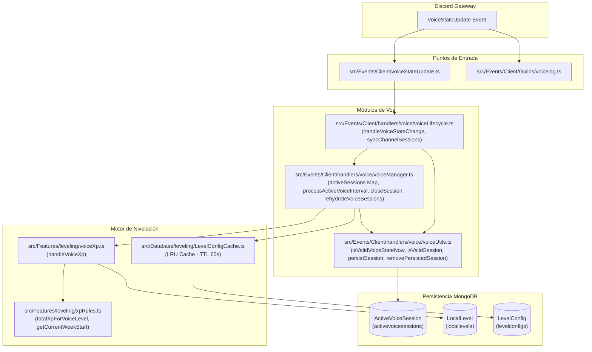

# Arquitectura Actual del Sistema Voice XP

## 1. Visión General

El sistema de **Voice XP** en Hoshiko (HannaeX) recompensa a los usuarios de Discord en función del tiempo que permanecen en canales de voz en cada servidor (`guildId`).

A diferencia de la experiencia por texto (`textXp.ts`), que reacciona a eventos discretos e instantáneos de mensaje (`messageCreate`), la experiencia de voz es un sistema **continuo y con estado (stateful)**. Requiere registrar la entrada al canal, controlar transiciones de estado de voz (ensordecimiento, silencio, cambio de canal) y contabilizar el tiempo acumulado mediante checkpoints periódicos y cierres controlados.



---

## 2. Inventario de Componentes y Responsabilidades

| Componente | Archivo Fuente | Líneas Clave | Responsabilidad |
| :--- | :--- | :--- | :--- |
| **Listener Principal Gateway** | [`src/Events/Client/voiceStateUpdate.ts`](file:///home/hanna/HannaeX/src/Events/Client/voiceStateUpdate.ts) | L9-L14 | Listener de Discord.js registrado en el cargador de eventos; redirige los eventos a `handleVoiceStateChange`. Exporta además las utilidades de inicio y rehidratación. |
| **Listener de Auditoría y Logs** | [`src/Events/Client/Guilds/voicelog.ts`](file:///home/hanna/HannaeX/src/Events/Client/Guilds/voicelog.ts) | L100-L167 | Listener secundario que gestiona registros en el canal de `voicelog` y monitoriza el VC Thrashing (cambios rápidos repetitivos). No participa en la acreditación de XP. |
| **Lifecycle Coordinator** | [`src/Events/Client/handlers/voice/voiceLifecycle.ts`](file:///home/hanna/HannaeX/src/Events/Client/handlers/voice/voiceLifecycle.ts) | L10-L55 (syncChannelSessions)<br/>L57-L92 (handleVoiceStateChange) | Determina si un cambio de estado implica entrada, salida, mute/unmute o cambio de canal; sincroniza todos los usuarios afectados en los canales origen y destino. |
| **Session Manager** | [`src/Events/Client/handlers/voice/voiceManager.ts`](file:///home/hanna/HannaeX/src/Events/Client/handlers/voice/voiceManager.ts) | L22 (activeSessions)<br/>L29 (rehydrate)<br/>L81 (closeSession)<br/>L123 (intervalo 5m) | Administra la colección en memoria `activeSessions`, ejecuta el temporizador en segundo plano cada 5 minutos, liquida sesiones y restaura el estado tras reinicios. |
| **Voice Utilities** | [`src/Events/Client/handlers/voice/voiceUtils.ts`](file:///home/hanna/HannaeX/src/Events/Client/handlers/voice/voiceUtils.ts) | L8 (isValidSession)<br/>L17 (isValidVoiceStateNow)<br/>L27 (persistSession)<br/>L47 (removePersistedSession) | Contiene las funciones de validación de elegibilidad del miembro/canal y realiza las operaciones directas de escritura en `ActiveVoiceSession`. |
| **Voice XP Engine** | [`src/Features/leveling/voiceXp.ts`](file:///home/hanna/HannaeX/src/Features/leveling/voiceXp.ts) | L4 (handleVoiceXp)<br/>L32 (getActivityMultiplier)<br/>L65 (actualización atómica) | Aplica el factor decreciente de tiempo continuo, calcula la ganancia de XP, comprueba el corte semanal y actualiza el documento de `LocalLevel`. |
| **Reglas y Fórmulas** | [`src/Features/leveling/xpRules.ts`](file:///home/hanna/HannaeX/src/Features/leveling/xpRules.ts) | L11 (xpForVoiceLevel)<br/>L15 (totalXpForVoiceLevel)<br/>L26 (getCurrentWeekStart) | Define las fórmulas matemáticas para niveles de voz: curva de experiencia (`80 + level * 40`) y cálculo del timestamp del lunes 00:00:00. |
| **Modelo Sesión Activa** | [`src/Database/leveling/activeVoiceSession.model.ts`](file:///home/hanna/HannaeX/src/Database/leveling/activeVoiceSession.model.ts) | L12-L26 | Esquema Mongoose de `ActiveVoiceSession` para persistencia intermedia con índice único `{ userId: 1, guildId: 1 }` e índice TTL en `{ start: 1 }`. |
| **Modelo Progreso Permanente** | [`src/Database/leveling/localLevel.model.ts`](file:///home/hanna/HannaeX/src/Database/leveling/localLevel.model.ts) | L29-L75 | Esquema Mongoose que almacena `voiceXp`, `voiceLevel`, `voiceMinutes`, `weeklyVoiceMinutes` y `weekStartDate`. |
| **Caché de Configuración** | [`src/Database/leveling/LevelConfigCache.ts`](file:///home/hanna/HannaeX/src/Database/leveling/LevelConfigCache.ts) | L4-L24 | Caché LRU en memoria con TTL de 60 segundos y capacidad máxima de 500 entradas para evitar consultas recurrentes a `LevelConfig`. |

---

## 3. Estado en Memoria vs. Persistencia en Base de Datos

### 3.1. Estado en Memoria (`activeSessions`)
Ubicado en [`voiceManager.ts#L22`](file:///home/hanna/HannaeX/src/Events/Client/handlers/voice/voiceManager.ts#L22):
```typescript
export interface VoiceSessionData {
  start: number;          // Timestamp (ms) del inicio del intervalo en curso
  originalStart: number;  // Timestamp (ms) de inicio de la sesión continua (preservado entre canales)
  userId: string;         // ID de Discord del usuario
  guildId: string;        // ID del servidor de Discord
  channelId: string;      // ID del canal de voz donde reside el usuario
  token: string;          // Identificador único (UUID v4) para validar pertenencia de la sesión
}

export const activeSessions = new Map<string, VoiceSessionData>();
```
- **Clave del Map:** `sessionKey(userId, guildId)` -> `${userId}:${guildId}`.
- **Ámbito:** Exclusivo del proceso Node.js.
- **Invariante de Diseño:** Solo puede existir como máximo una sesión activa por usuario por servidor a la vez.

### 3.2. Persistencia Temporal (`ActiveVoiceSession`)
Ubicado en [`activeVoiceSession.model.ts`](file:///home/hanna/HannaeX/src/Database/leveling/activeVoiceSession.model.ts):
```typescript
const activeVoiceSessionSchema = new Schema({
  userId: { type: String, required: true },
  guildId: { type: String, required: true },
  channelId: { type: String, required: true },
  start: { type: Date, required: true },
  originalStart: { type: Date, required: true },
  token: { type: String, required: true },
});

activeVoiceSessionSchema.index({ userId: 1, guildId: 1 }, { unique: true });
activeVoiceSessionSchema.index({ start: 1 }, { expireAfterSeconds: 60 * 60 * 24 });
```
- **Propósito:** Permitir la recuperación de sesiones en curso tras caídas imprevistas o reinicios del proceso bot.
- **Escrituras:**
  - `persistSession()` ejecuta `ActiveVoiceSession.findOneAndUpdate({ userId, guildId }, { ... }, { upsert: true }).catch(() => null)`.
- **Eliminaciones:**
  - `removePersistedSession()` ejecuta `ActiveVoiceSession.deleteOne({ userId, guildId }).catch(() => null)`.

### 3.3. Persistencia Permanente (`LocalLevel`)
Ubicado en [`localLevel.model.ts`](file:///home/hanna/HannaeX/src/Database/leveling/localLevel.model.ts):
Almacena el balance consolidado del usuario en ese servidor:
- `voiceXp` (Number): Total acumulado histórico de XP de voz.
- `voiceLevel` (Number): Nivel alcanzado en el sistema de voz.
- `voiceMinutes` (Number): Minutos totales reales pasados en canales de voz elegibles.
- `weeklyVoiceMinutes` (Number): Minutos de voz acumulados en la semana en curso.
- `weekStartDate` (Date): Timestamp de corte de la semana registrada.

---

## 4. Reglas de Negocio Implementadas

### 4.1. Criterio de Acompañamiento Obligatorio (Anti-Farmeo Solitario)
Un usuario no puede ganar XP si está solo en un canal de voz. La regla se evalúa en `isValidVoiceStateNow` y `isValidSession`:
```typescript
state.channel.members.filter((m) => !m.user.bot).size >= 2
```
Se exige que existan al menos 2 miembros que no tengan el flag de bot.

### 4.2. Inelegibilidad por Silencio o Ensordecimiento
El usuario queda descalificado para ganar XP si presenta cualquiera de los siguientes estados en su `VoiceState`:
- `selfMute === true` (silenciado por sí mismo).
- `selfDeaf === true` (ensordecido por sí mismo).
- `serverMute === true` (silenciado por moderación del servidor).
- `serverDeaf === true` (ensordecido por moderación del servidor).
- Canal actual igual al canal AFK del servidor (`guild.afkChannelId === state.channelId`).
- El usuario es un bot (`member.user.bot === true`).

### 4.3. Curva de Rendimiento Decreciente por Sesión Continua
Para evitar abusos por llamadas continuas desatendidas de muchas horas, `handleVoiceXp` aplica una escala decreciente calculada sobre `totalSessionMinutes` (el tiempo transcurrido desde `originalStart`):
```typescript
function getActivityMultiplier(mins: number): number {
  if (mins <= 180) return 1.0; // 0 a 3 horas  -> 100% XP
  if (mins <= 240) return 0.75; // 3 a 4 horas  -> 75% XP
  if (mins <= 300) return 0.5; // 4 a 5 horas  -> 50% XP
  if (mins <= 420) return 0.25; // 5 a 7 horas  -> 25% XP
  return 0.1;                   // Más de 7 horas -> 10% XP mínimo
}
```
`originalStart` se preserva explícitamente cuando un usuario salta de un canal a otro en [`voiceLifecycle.ts#L33`](file:///home/hanna/HannaeX/src/Events/Client/handlers/voice/voiceLifecycle.ts#L33) mediante el mapa local `previousStarts`.

### 4.4. Progresión Matemática de Nivel de Voz
A diferencia del nivel de texto (`100 + level * 50`), la fórmula de voz en `xpRules.ts` requiere:
```typescript
export function xpForVoiceLevel(level: number): number {
  return Math.floor(80 + level * 40);
}
```
La XP acumulada para alcanzar un nivel `N` es la suma de `xpForVoiceLevel(i)` desde `i = 0` hasta `N - 1`.

---

## 5. Ciclo de Apagado (Shutdown) y Manejo de Señales

En [`src/lifecycle/shutdown.ts`](file:///home/hanna/HannaeX/src/lifecycle/shutdown.ts) y [`src/App/bootstrap/ShutdownService.ts`](file:///home/hanna/HannaeX/src/App/bootstrap/ShutdownService.ts):
- Durante un `SIGTERM` o `SIGINT`, `ShutdownService.shutdown()` detiene Discord (`client.destroy()`), cierra el servidor de salud HTTP, cierra la conexión de Redis y finalmente desconecta MongoDB (`disconnectMongo()`).
- **Comportamiento Crítico Actual:** En ningún punto del ciclo de apagado se invoca a `voiceManager` para liquidar o consolidar las sesiones activas presentes en `activeSessions`. El proceso simplemente termina y confía en la rehidratación posterior al arrancar de nuevo.
