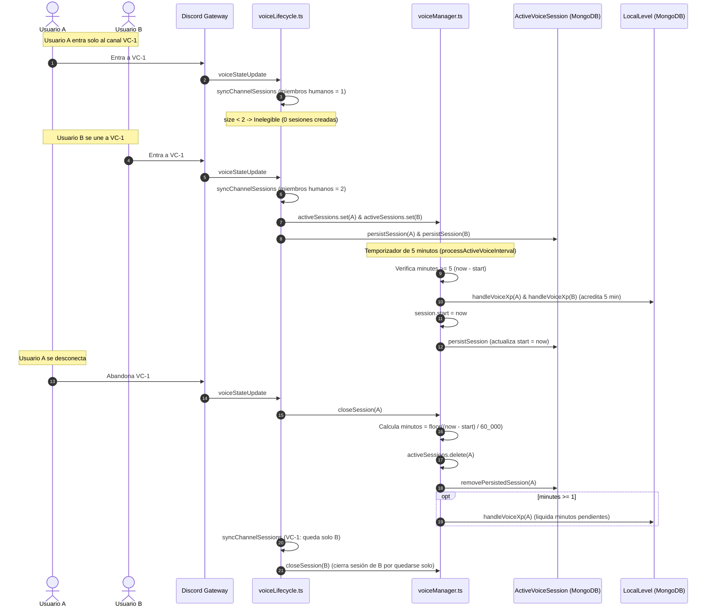
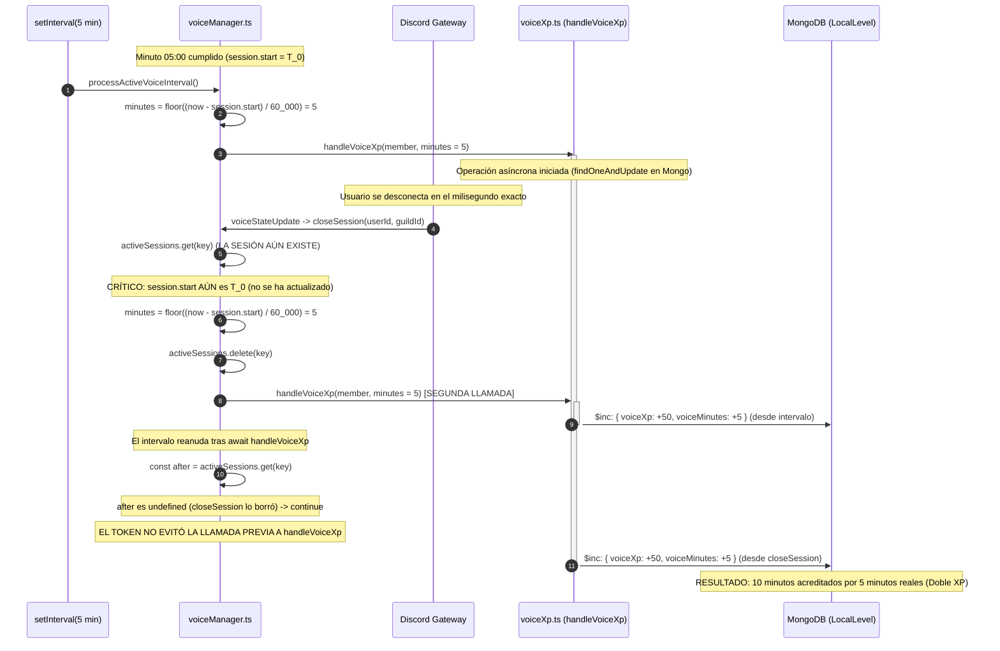
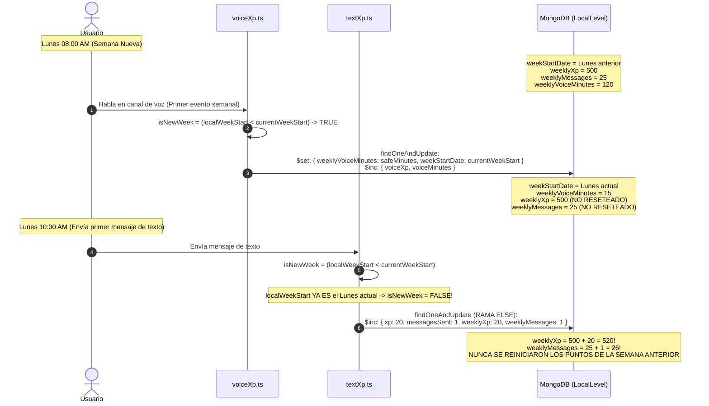
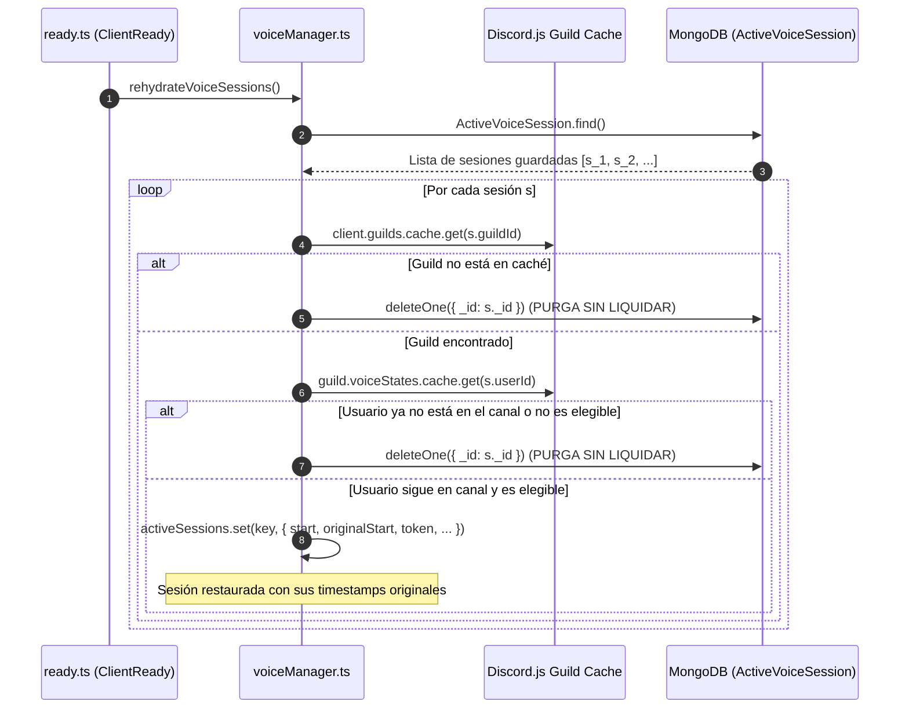

# Flujo de Eventos y Ciclo de Vida de Voice XP

## 1. Diagramas de Flujo del Ciclo de Vida

### 1.1. Ciclo de Vida General de una Sesión de Voz

---

### 1.2. Escenario de Concurrencia Crítica: Intervalo de 5m vs. Desconexión (`V03`)

---

### 1.3. Escenario de Desincronización del Reset Semanal (`V02`)

---

### 1.4. Flujo de Rehidratación tras Reinicio del Bot (`V05`)

---

## 2. Descripción Paso a Paso de Escenarios de Ejecución

### Escenario A: Usuario A entra a un canal vacío
1. Discord Gateway emite el evento `VoiceStateUpdate` (`oldState.channelId = null`, `newState.channelId = "vc-1"`).
2. [`src/Events/Client/voiceStateUpdate.ts#L11`](file:///home/hanna/HannaeX/src/Events/Client/voiceStateUpdate.ts#L11) invoca `handleVoiceStateChange(oldState, newState)`.
3. `handleVoiceStateChange` detecta que `oldState.channelId` no existía y `newState.channelId` existe; llama a `syncChannelSessions(newState.channel, guildId, now, previousStarts)`.
4. `syncChannelSessions` itera sobre los miembros del canal `vc-1`. Solo está Usuario A.
5. Invoca `isValidVoiceStateNow(Usuario A)`. En [`voiceUtils.ts#L24`](file:///home/hanna/HannaeX/src/Events/Client/handlers/voice/voiceUtils.ts#L24), `state.channel.members.filter((m) => !m.user.bot).size >= 2` evalúa a `1 >= 2` (**FALSO**).
6. La variable `eligible` es falsa. Al no existir sesión previa (`!existing`), no se ejecuta ninguna acción.
7. **Resultado:** Usuario A permanece en el canal sin sesión abierta y sin acumular tiempo.

---

### Escenario B: Usuario B entra al canal con Usuario A
1. Discord Gateway emite `VoiceStateUpdate` para Usuario B.
2. `handleVoiceStateChange` invoca `syncChannelSessions(newState.channel, ...)`.
3. `syncChannelSessions` itera sobre los dos miembros del canal:
   - **Para Usuario A:** `isValidVoiceStateNow` evalúa `size >= 2` (**VERDADERO**). Al no tener sesión (`!existing`), genera un nuevo UUID `token`, `start = now`, `originalStart = now`. Registra la sesión en `activeSessions` y llama a `persistSession()` en MongoDB.
   - **Para Usuario B:** `isValidVoiceStateNow` evalúa `size >= 2` (**VERDADERO**). Genera su `token`, `start = now`, `originalStart = now`. Registra en `activeSessions` y en MongoDB.
4. **Resultado:** Ambos usuarios inician sesión simultáneamente con timestamps sincronizados.

---

### Escenario C: Usuario A se silencia (`selfMute = true`)
1. Discord Gateway emite `VoiceStateUpdate` con `newState.selfMute = true`.
2. `handleVoiceStateChange` invoca `syncChannelSessions(vc-1)`.
3. Para Usuario A:
   - `isValidVoiceStateNow(Usuario A)` comprueba `state.selfMute === true` y retorna **FALSO**.
   - Entra en la rama `else if (existing && existing.channelId === channel.id)` en [`voiceLifecycle.ts#L51`](file:///home/hanna/HannaeX/src/Events/Client/handlers/voice/voiceLifecycle.ts#L51).
   - Ejecuta `await closeSession(Usuario A, guildId, now)`.
   - `closeSession` calcula `minutes = Math.floor((now - session.start) / 60_000)`.
   - Elimina la sesión de `activeSessions` y borra el documento de MongoDB mediante `removePersistedSession`.
   - Si `minutes < 1`, retorna inmediatamente. **Todo el tiempo transcurrido inferior a 60 segundos se pierde irrevocablemente.**
4. Para Usuario B:
   - `isValidVoiceStateNow(Usuario B)` evalúa `channel.members.filter((m) => !m.user.bot).size >= 2`.
   - Como Usuario A sigue presente físicamente en el canal, `size` sigue siendo 2.
   - **Resultado:** La sesión de Usuario B permanece abierta a pesar de que Usuario A está silenciado.

---

### Escenario D: Usuario A se desmutea (`selfMute = false`)
1. Discord Gateway emite `VoiceStateUpdate` con `newState.selfMute = false`.
2. `handleVoiceStateChange` invoca `syncChannelSessions(vc-1)`.
3. Para Usuario A:
   - `isValidVoiceStateNow(Usuario A)` evalúa a **VERDADERO**.
   - Como su sesión previa fue destruida en el Escenario C, `existing` es `undefined`.
   - `previousStarts.get(userId)` es `undefined` (porque la sesión no existía en `activeSessions` al iniciar el evento en [`voiceLifecycle.ts#L70`](file:///home/hanna/HannaeX/src/Events/Client/handlers/voice/voiceLifecycle.ts#L70)).
   - Se crea una sesión **completamente nueva**: `start = now`, `originalStart = now`.
4. **Resultado:** Se pierde la antigüedad acumulada de la sesión previa; la curva decreciente (`getActivityMultiplier`) se reinicia como si el usuario acabara de entrar al canal.

---

### Escenario E: Usuario A cambia de Canal (`vc-1` a `vc-2`)
1. Discord Gateway emite `VoiceStateUpdate` con `oldState.channelId = "vc-1"` y `newState.channelId = "vc-2"`.
2. `handleVoiceStateChange`:
   - Registra `previousStarts.set(userId, existing.originalStart)` en [`voiceLifecycle.ts#L72`](file:///home/hanna/HannaeX/src/Events/Client/handlers/voice/voiceLifecycle.ts#L72).
   - Detecta `oldState.channelId !== newState.channelId`: ejecuta `await closeSession(userId, guildId, now)`.
   - Liquida los minutos completos transcurridos en `vc-1` y descarta los segundos residuales.
   - Sincroniza `oldState.channel` (`vc-1`): Usuario B queda solo (`size = 1`), por lo que su sesión se cierra vía `closeSession(Usuario B)`.
   - Sincroniza `newState.channel` (`vc-2`): Si en `vc-2` hay al menos otro usuario, abre una nueva sesión para Usuario A recuperando `originalStart` desde `previousStarts` y asignando `start = now`.

---

### Escenario F: Barrido Periódico de 5 Minutos (`processActiveVoiceInterval`)
1. El temporizador creado en [`voiceManager.ts#L204`](file:///home/hanna/HannaeX/src/Events/Client/handlers/voice/voiceManager.ts#L204) ejecuta `processActiveVoiceInterval()` cada 300,000 ms.
2. Itera sobre cada entrada en `activeSessions`:
   - Si `minutes = Math.floor((now - session.start) / 60_000) < 5`, la omite.
   - Si `minutes >= 5`:
     - Comprueba `isValidVoiceStateNow(member)`. Si dejó de ser válido, cierra la sesión.
     - Valida `LevelConfigCache` (roles y canales ignorados).
     - Ejecuta `await handleVoiceXp(...)` acreditando `minutes`.
     - Actualiza `session.start = now` en memoria y persiste el nuevo `start` en MongoDB.

---

### Escenario G: Rehidratación tras Reinicio del Proceso Bot
1. Al dispararse el evento `Events.ClientReady` en [`ready.ts#L85`](file:///home/hanna/HannaeX/src/Events/Client/ready.ts#L85), se ejecuta `await rehydrateVoiceSessions()`.
2. Consulta todos los documentos en `ActiveVoiceSession.find()`.
3. Comprueba el estado actual de cada usuario en el caché de Discord.js:
   - Si el usuario continúa conectado en el mismo canal y cumple `isValidSession()`, restaura la sesión en memoria manteniendo `start` y `originalStart`.
   - Si el usuario se desconectó mientras el bot estuvo apagado, **elimina el documento de MongoDB sin liquidar el tiempo acumulado previo al reinicio**.
