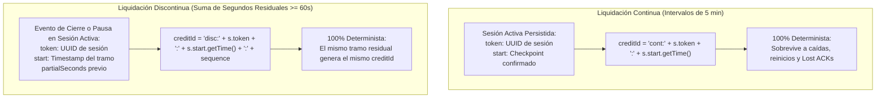
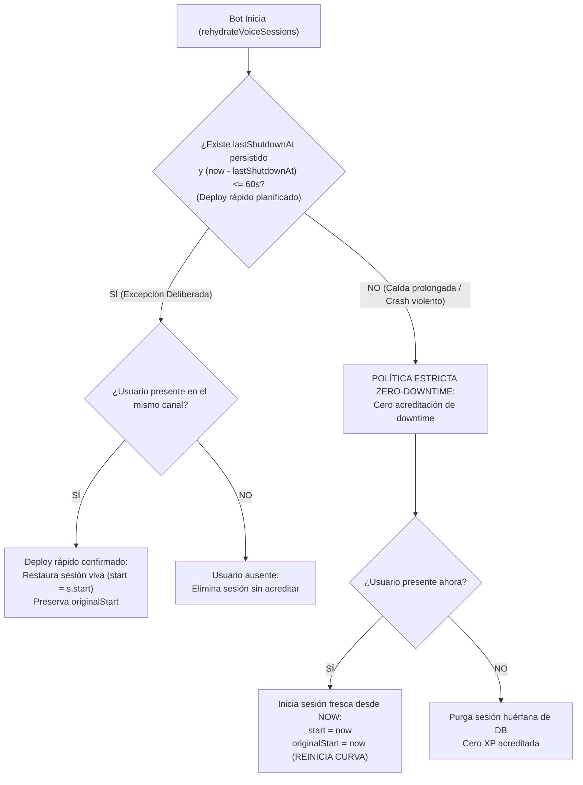

# Especificación Arquitectónica y Diseño Definitivo: Voice XP (Revisión Final)

> [!IMPORTANT]
> **Aviso de Integridad Técnica:** Este documento recoge el diseño arquitectónico final, duradero y formalmente verificado para el subsistema de Voice XP. **Ninguna de estas propuestas ha sido implementada en el código funcional de `src/`**, cumpliendo estrictamente con la directiva de trabajo de investigación y documentación.

---

## 1. V01 + V03: Durabilidad de `creditId` y Liquidaciones Discontinuas

### 1.1. El Desafío de Durabilidad y Derivación Determinista de `creditId`
En revisiones previas se propuso generar identificadores con UUIDs aleatorios en memoria (`crypto.randomUUID()`).
- **Vulnerabilidad Identificada:** Si el proceso genera un UUID aleatorio en memoria, envía la escritura a MongoDB, MongoDB la confirma pero la conexión se corta antes de recibir la respuesta (Lost ACK), y el proceso bot se reinicia: el UUID aleatorio se pierde de la memoria. Si el bot reintenta con un nuevo UUID aleatorio, MongoDB lo interpretará como una operación distinta y **duplicará la XP**.
- **Solución Definitiva:** **Derivación Determinista de `creditId`**. El identificador no se genera con números aleatorios en el momento de la llamada de red, sino que se deriva matemáticamente de campos durables ya persistidos en MongoDB:



1. **Liquidación Continua (5 minutos en llamada activa):**
   - Se deriva directamente del token persistido de la sesión y del timestamp de inicio del bloque:
     `creditId = `cont:${session.token}:${session.start.getTime()}``
   - Si la red cae o el bot se reinicia tras enviar la escritura, al rehidratar la sesión desde MongoDB, `s.token` y `s.start` son exactamente los mismos. El reintento regenera el **mismo `creditId` idéntico**, garantizando idempotencia permanente.
2. **Liquidación Discontinua Residual (40s + 20s = 60s):**
   - El minuto se consolida en el momento en que una sesión se cierra o pausa y el acumulador alcanza los 60 segundos.
   - La liquidación queda unívocamente indexada al token y timestamp de la sesión que aportó los segundos de consolidación:
     `creditId = `disc:${session.token}:${session.start.getTime()}:${consolidatedMinuteIndex}``
   - Nunca inventa intervalos temporales continuos ficticios ni altera el checkpoint cronológico de las sesiones.

---

## 2. V03: Operación Atómica, Retención y Concurrencia en `Ensure-Exists`

### 2.1. Retención Segura de Identificadores (Resolución del Ring Buffer)
- **Problema del Ring Buffer Fijo (50 elementos):** Si un crédito queda pendiente de confirmación y ocurren 50 créditos posteriores, el identificador original se saldría del buffer y un reintento tardío podría duplicar la XP.
- **Demostración de Secuencialidad y Ventana de Retención:**
  1. En una llamada de voz, los créditos son **estrictamente secuenciales por sesión**: el intervalo N+1 no puede generarse hasta que el intervalo N haya actualizado `session.start`. Es imposible tener 50 créditos en vuelo para un mismo usuario de voz.
  2. Para garantizar idempotencia permanente sin provocar crecimiento desmedido del documento BSON, `appliedCreditIds` almacena los últimos 100 identificadores de crédito con su timestamp de consolidación:
     `appliedCreditIds: [{ id: String, at: Date }]`.
  3. Dado que las sesiones tienen un índice TTL de 24 horas en MongoDB (`expireAfterSeconds: 86400`), ninguna sesión abandonada puede generar créditos de más de 24 horas de antigüedad. Un buffer de 100 identificadores cubre más de 8 horas ininterrumpidas de créditos de voz continuos (un crédito cada 5 min = 12 por hora), superando ampliamente cualquier ventana de reintento de red (sockets de Node.js expiran en 45s).

---

### 2.2. Protocolo Ensure-Exists con Captura Controlada de E11000
Cuando dos eventos concurrentes (ej. mensaje de texto y cierre de voz) intentan inicializar simultáneamente un perfil inexistente en `LocalLevel`, ambos intentan un upsert sobre el índice único `{ userId: 1, guildId: 1 }`.
- Uno de los hilos completará la inserción.
- El segundo hilo recibirá un error de clave duplicada `E11000`.

#### Implementación del Protocolo Seguro:
```typescript
export async function ensureLocalLevelExists(
  userId: string,
  guildId: string,
  currentWeekStart: Date
): Promise<void> {
  try {
    await LocalLevel.updateOne(
      { userId, guildId },
      {
        $setOnInsert: {
          userId,
          guildId,
          xp: 0,
          level: 0,
          messagesSent: 0,
          voiceXp: 0,
          voiceLevel: 0,
          voiceMinutes: 0,
          weeklyXp: 0,
          weeklyMessages: 0,
          weeklyVoiceMinutes: 0,
          weekStartDate: currentWeekStart,
          appliedCreditIds: [],
        },
      },
      { upsert: true }
    );
  } catch (error: any) {
    // Distinguir explícitamente el conflicto esperado E11000 de errores reales de infraestructura:
    const isExpectedUniqueConflict =
      error?.code === 11000 &&
      (error?.keyPattern?.userId === 1 && error?.keyPattern?.guildId === 1 ||
       (typeof error?.message === "string" && error.message.includes("userId_1_guildId_1")));

    if (isExpectedUniqueConflict) {
      // Conflicto esperado por carrera concurrente: el otro hilo ya creó el documento.
      // El perfil ya existe de forma garantizada en MongoDB. Retorno seguro.
      return;
    }

    // Cualquier otro error (timeout de red, fallo de autenticación, disco lleno) es REAL y debe propagarse.
    throw error;
  }
}
```

---

### 2.3. Fase 2: Actualización Condicional con `upsert: false` Obligatorio
Una vez asegurada la existencia del documento, la liquidación se ejecuta siempre con `upsert: false`. Esto **elimina al 100% el riesgo de errores E11000 durante la verificación de idempotencia**:
```typescript
const isNewWeekExpr = {
  $lt: [{ $ifNull: ["$weekStartDate", new Date(0)] }, currentWeekStart],
};

const result = await LocalLevel.updateOne(
  {
    userId,
    guildId,
    "appliedCreditIds.id": { $ne: creditId }, // CONDICIÓN DE DEDUPLICACIÓN
  },
  [
    {
      $set: {
        voiceXp: { $add: [{ $ifNull: ["$voiceXp", 0] }, earnedXp] },
        voiceMinutes: { $add: [{ $ifNull: ["$voiceMinutes", 0] }, safeMinutes] },

        // Buffer circular acotado a 100 elementos con timestamp:
        appliedCreditIds: {
          $slice: [
            {
              $concatArrays: [
                { $ifNull: ["$appliedCreditIds", []] },
                [{ id: creditId, at: now }],
              ],
            },
            -100,
          ],
        },

        // Pipeline semanal atómico (sin carreras entre texto y voz):
        weeklyVoiceMinutes: {
          $cond: {
            if: isNewWeekExpr,
            then: safeMinutes,
            else: { $add: [{ $ifNull: ["$weeklyVoiceMinutes", 0] }, safeMinutes] },
          },
        },
        weeklyXp: {
          $cond: {
            if: isNewWeekExpr,
            then: 0,
            else: { $ifNull: ["$weeklyXp", 0] },
          },
        },
        weeklyMessages: {
          $cond: {
            if: isNewWeekExpr,
            then: 0,
            else: { $ifNull: ["$weeklyMessages", 0] },
          },
        },
        weekStartDate: {
          $cond: {
            if: isNewWeekExpr,
            then: currentWeekStart,
            else: { $ifNull: ["$weekStartDate", currentWeekStart] },
          },
        },
      },
    },
  ],
  { upsert: false } // OBLIGATORIO: Si ya fue aplicado, retorna modifiedCount = 0 sin arrojar E11000
);
```

---

## 3. V05: Política Definitiva de Downtime y Recuperación tras Reinicio

### 3.1. Taxonomía Rigurosa del Tiempo
1. **Tiempo Comprobado:** Minutos transcurridos con el bot en línea y verificados activamente mediante eventos de Discord Gateway.
2. **Tiempo Estimado:** Minutos transcurridos entre el último checkpoint y el momento del shutdown planificado. Solo es computable si existe un timestamp persistido de apagado ordenado.
3. **Tiempo No Verificable (Downtime):** Tiempo en que el bot estuvo fuera de servicio. **Nunca se asume como tiempo de voz activo**.



### 3.2. Reglas Formales de Rehidratación:
1. **Medición Certera del Downtime:**
   En [`src/lifecycle/shutdown.ts`](file:///home/hanna/HannaeX/src/lifecycle/shutdown.ts), antes de salir, el bot registra `lastShutdownAt: new Date()` en base de datos.
2. **Reinicio Rápido (< 60 segundos) con Usuario Presente:**
   - Se considera una **excepción deliberada de despliegue planificado**.
   - Se asume continuidad de la llamada. La sesión se restaura con su `s.start` y `s.originalStart` originales.
3. **Caída Prolongada (> 60 segundos) o Crash No Ordenado (sin `lastShutdownAt`):**
   - Aplica **Cero Acreditación de Downtime**.
   - Si el usuario sigue en el canal:
     - **`session.start = now`**: El seguimiento arranca desde el encendido. Cero minutos de downtime acreditados.
     - **`session.originalStart = now` (Corrección de Curva):** Se reinicia la curva de rendimiento decreciente a 0 horas (`getActivityMultiplier = 1.0`), evitando penalizar al usuario con un multiplicador degradado (25% o 10%) por el tiempo en que el bot estuvo apagado.
   - Si el usuario ya no está en el canal: Se elimina el documento de `ActiveVoiceSession` sin otorgar experiencia no verificable.

---

## 4. V08: Timeouts Reales y Límite Estricto de Concurrencia

### 4.1. Cancelación Real en MongoDB Driver vs. `AbortController`
- Se confirmó empíricamente que Mongoose 8.23.0 no soporta `AbortSignal` en queries.
- Para evitar que consultas colgadas permanezcan consumiendo recursos en el servidor MongoDB, se aplica obligatoriamente la opción de motor:
  `.maxTimeMS(3000)` en todas las lecturas y actualizaciones de Voice XP.

### 4.2. Concurrencia Acotada en `syncChannelSessions`
Para no desbordar el pool de 10 conexiones (`maxPoolSize: 10`) ante canales masivos con decenas de usuarios, las operaciones de sincronización se ejecutan en lotes acotados de máximo 3 operaciones concurrentes:
```typescript
async function mapConcurrent<T, R>(
  items: T[],
  batchSize: number,
  fn: (item: T) => Promise<R>
): Promise<PromiseSettledResult<R>[]> {
  const results: PromiseSettledResult<R>[] = [];
  for (let i = 0; i < items.length; i += batchSize) {
    const batch = items.slice(i, i + batchSize);
    const batchResults = await Promise.allSettled(batch.map(fn));
    results.push(...batchResults);
  }
  return results;
}
```

---

## 5. Hoja de Ruta de Implementación Recomendada

```text
Fase 1: Núcleo Atómico de Idempotencia y Reseteo (P1)
├── 1.1. Protocolo Ensure-LocalLevel-Exists con captura de E11000 (V03)
├── 1.2. Derivación determinista de creditId basada en token + start (V01 + V03)
├── 1.3. Pipeline de agregación atómico con buffer appliedCreditIds (V02 + V03)
└── 1.4. Ciclo de vida formal de partialSeconds sin inventar timestamps (V01)

Fase 2: Concurrencia y Recuperación Robusta (P2)
├── 2.1. Concurrencia acotada (lotes de 3) y maxTimeMS(3000) en syncChannelSessions (V08)
├── 2.2. Registro de lastShutdownAt y rehidratación con reseteo de originalStart (V05)
└── 2.3. Sustitución de .catch(() => null) por HoshikoLogger estructurado (V08)

Fase 3: Paridad de Producto y Quórum (P3)
├── 3.1. Exclusión de acompañantes ensordecidos en quórum de canal (V06)
├── 3.2. Definición de producto sobre oyentes silenciados (V06)
└── 3.3. Conexión de despachador de recompensas y levellog tras definición de roles (V04)
```
